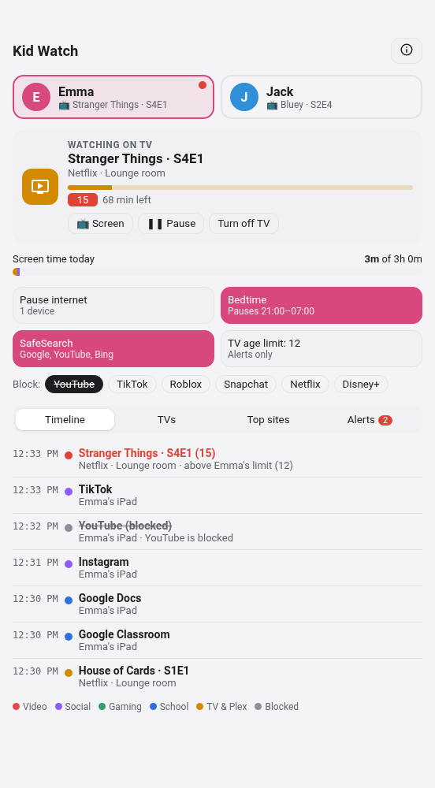
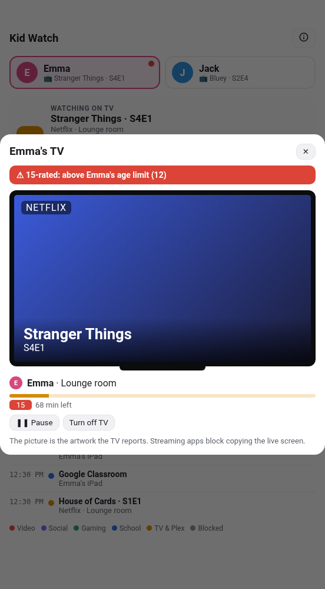
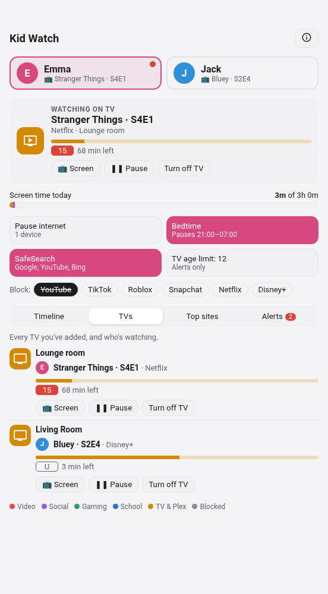
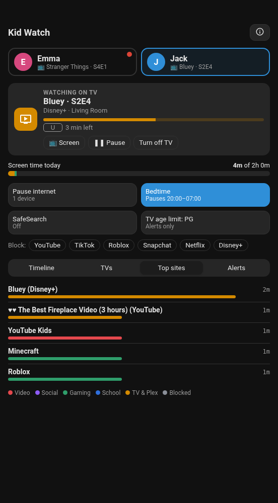

# Kid Watch for Home Assistant

See what each of your children is watching or using right now, how much screen time they've had today, and what they've been up to this evening. Pause their internet, set a bedtime, turn on SafeSearch or block apps with one tap. Kid Watch works with [AdGuard Home](https://github.com/AdguardTeam/AdGuardHome), your TVs, and Plex.

> **Beta (v0.2.0).** It has been tested against a real AdGuard Home (v0.107.79) with Home Assistant 2026.9 and 2026.10, first in a sandbox and now in a real home. Please [open an issue](https://github.com/spikey1965/ha-kid-watch/issues) if something doesn't work on your setup.

<p>


</p>

## What it does

- **Now:** what each child is doing right now, such as "Watching Bluey S2E4 on Disney+, Living Room TV" or "Roblox on Jack's iPad".
- **Screen time:** minutes used today, split by video, social, gaming, school and TV, against a daily budget you set.
- **Timeline:** the apps and shows they used today and when, plus anything that was blocked.
- **TVs:** every TV you've added, what's on it, its age rating and time left. Each one has **Pause** and **Turn off TV** buttons.
- **TV age limit:** each child gets a limit (U, PG, 12, 15, 18). If a show above it starts, you get an alert and the card pops up the TV. You can also have the TV stopped automatically.
- **Controls** for each child, all done through AdGuard Home:
  - **Pause internet**: blocks all of their devices.
  - **Bedtime**: pauses at a set time and resumes in the morning.
  - **SafeSearch** for Google, YouTube, Bing and others.
  - **Block** buttons for apps like YouTube, TikTok, Roblox, Snapchat, Netflix and Disney+. You choose which buttons appear.
- **Alerts** go to any notify service: the Home Assistant phone app, Gotify, Telegram, email and so on. You get one when a child:
  - tries a blocked adult or dangerous site;
  - starts a show above their age limit;
  - tries an app you've blocked;
  - uses up their screen time;
  - is paused for bedtime.
- Everything stays on your network. Kid Watch only talks to your own AdGuard Home and Home Assistant.

## Languages

Kid Watch speaks **English, Deutsch, Français, Italiano, Español, Nederlands, Polski and Português** (including Brazilian Portuguese).

- The **setup screens** and **entity names** follow each user's language in Home Assistant.
- The **card** follows your language too. To choose one for a card, add `language: de` (`en`, `de`, `fr`, `it`, `es`, `nl`, `pl`, `pt`, `pt-BR`).
- **Alerts and the timeline** use Home Assistant's system language (**Settings → System → General**), because they're written once for everyone.
- Age ratings (U, PG, 12, 15, 18, TV-MA…) stay as they are, since they're official names.

Spotted a wrong word in your language? Please [open an issue](https://github.com/spikey1965/ha-kid-watch/issues).

## What it can and can't see

- **It sees** which apps and sites each device uses, from AdGuard Home's DNS log.
- **On TVs it sees** what's playing:
  - Plex reports exact titles, episodes and age ratings.
  - Apple TV usually reports the title for Netflix, Disney+, iPlayer and YouTube.
  - Many smart TVs (Samsung, LG) only report the app name.
- **It can't see** single pages, searches, or which YouTube video is playing. HTTPS hides those.
- **It can't see** anything on mobile data, or on a device that uses its own DNS (private DNS, VPNs, iCloud Private Relay). For phones away from home, use Apple Screen Time or Google Family Link alongside Kid Watch.

### Stop iCloud Private Relay hiding a child's browsing

On iPhones, iPads and Macs with iCloud+, Private Relay sends Safari's lookups through Apple, so AdGuard (and Kid Watch) never sees them. Kid Watch tags every child's AdGuard client `user_child`, so you can switch Private Relay off for the children only. In AdGuard Home → **Filters → Custom filtering rules**, add:

```
||mask.icloud.com^$ctag=user_child
||mask-h2.icloud.com^$ctag=user_child
```

Their devices then show "Private Relay is unavailable on this network" at home and use your normal DNS. iCloud itself (Photos, backups, iMessage, icloud.com) keeps working, and adults' devices keep Private Relay.
- **Age ratings** come from what the TV or Plex reports. Shows without a rating never trigger an alert.

## What you need

- **AdGuard Home** as the DNS server for the children's devices, usually set in your router's DHCP. The query log must be on (it is by default).
- **Optional:** the [Plex integration](https://www.home-assistant.io/integrations/plex/) in Home Assistant. Then each child's Plex profile follows them to any TV.
- **Optional:** your TVs or streaming boxes in Home Assistant as media players (Apple TV, Android TV, Samsung, LG, Roku…).

**Tip:** give each child's device a fixed address in your router, and turn off "private Wi-Fi address" (iPhone/iPad) or "randomised MAC" (Android) for your home network. Then the device keeps the same address. Naming the devices in AdGuard Home (**Settings → Client settings**) makes them easy to pick.

## Install

**With HACS:**
1. HACS → ⋮ → **Custom repositories** → add `https://github.com/spikey1965/ha-kid-watch`, type **Integration**.
2. Search for **Kid Watch** → **Download**.
3. Restart Home Assistant.

**By hand:** copy `custom_components/kid_watch` into your `config/custom_components/` folder and restart Home Assistant.

The dashboard card comes with the integration. You don't need to add a resource.

## Set up

1. **Settings → Devices & services → Add integration → Kid Watch.**
2. **Connect:** enter AdGuard Home's address, port, username and password.
3. **Add a child:**
   - their name and a colour;
   - their **devices**, picked from AdGuard's list;
   - their **TVs**;
   - their **Plex profile**, if they have one;
   - their **TV age limit**, **daily screen time**, **bedtime** and **wake-up time**.
4. Add more children, then choose where **alerts** go and which **block buttons** to show.

To add, edit or remove a child later, use **Configure** on the Kid Watch integration.

## The card

```yaml
type: custom:kid-watch-card
```

Options:

| Option | Default | What it does |
|---|---|---|
| `title` | `Kid Watch` | Card title |
| `children` | all | Only show these children, e.g. `[Emma]` |
| `popup` | `true` | Pop up the TV when a show above a child's age limit starts |
| `language` | your HA language | Card language: `en`, `de`, `fr`, `it`, `es`, `nl`, `pl`, `pt` or `pt-BR` |

<p>


</p>

## Entities

Each child gets a device with these entities. The IDs below are for English; in another language Home Assistant names them in that language (for example `switch.emma_tiktok_sperren` in German).

| Entity | What it is |
|---|---|
| `sensor.<child>_status` | What they're doing now (`Idle` or `Paused` otherwise). Its attributes carry the day's data for the card. |
| `sensor.<child>_screen_time_today` | Minutes today, split by category |
| `sensor.<child>_alerts_today` | Number of alerts today, with the latest one |
| `switch.<child>_pause_internet` | Blocks all their devices in AdGuard Home |
| `switch.<child>_bedtime` | Pause at bedtime, resume at wake-up time |
| `switch.<child>_safesearch` | SafeSearch on their devices |
| `switch.<child>_stop_over_age_tv` | Stop the TV when a show above their limit starts |
| `switch.<child>_block_<app>` | One for each block button you chose |

Every alert also fires a `kid_watch_alert` event (`child`, `type`, `title`, `message`), so you can build your own automations. For example, flash a light when a TV age-limit alert comes in:

```yaml
triggers:
  - trigger: event
    event_type: kid_watch_alert
    event_data:
      type: tv
actions:
  - action: light.turn_on
    target:
      entity_id: light.living_room
    data:
      flash: short
```

## How it changes AdGuard Home

- **Pause internet** adds a rule for that child's devices to your custom filtering rules, marked `! kid_watch pause <child>`. Resuming removes it.
- **SafeSearch** and **block buttons** switch that device from AdGuard's global settings to its own settings. Those start as a copy of your global ones.
- If you pick a device AdGuard only knows by its address, Kid Watch makes it a named client ("Emma (192.168.1.42)") the first time you use a control.
- Removing a child from Kid Watch leaves their AdGuard settings as they are.

## Privacy

Kid Watch keeps only today's activity: the timeline, top sites and alerts. It's stored in Home Assistant's `.storage` folder and cleared at midnight. The detailed attributes are kept out of Home Assistant's history database. Please tell your children what Kid Watch can see; being open about it works better than secret monitoring.

## Licence

MIT
